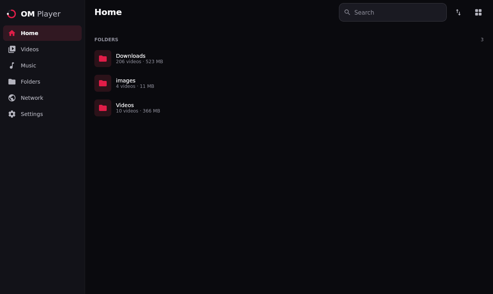
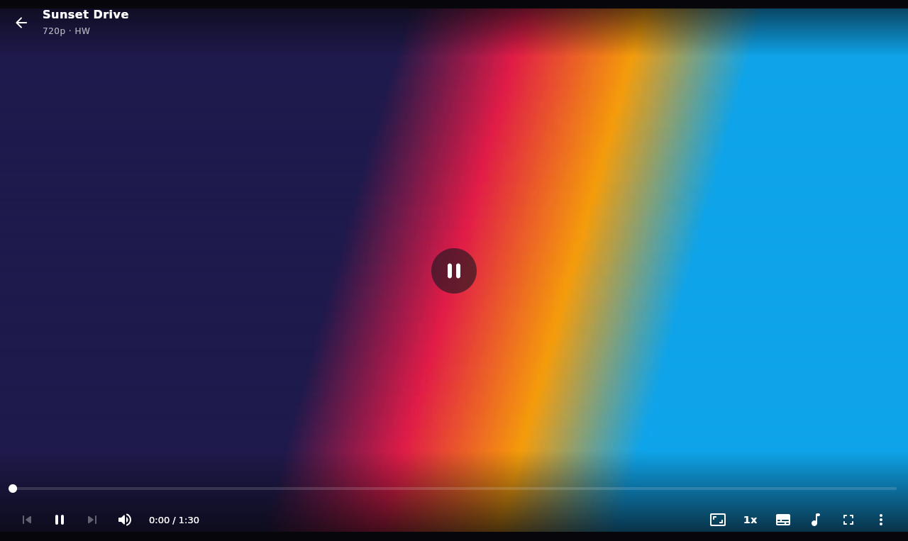

# OM Player

An ad-free video and music player for **Android** and **PC** (Linux, Windows). No account, no ads, no online feed, and only the permissions a player needs.

<p>
  
  
</p>

## Download

Get the latest build from the [Releases page](https://github.com/omarahmedpl/OM_Player/releases/latest).

| Platform | File | Notes |
|---|---|---|
| Android 8.0+ | `om-player-1.0.0.apk` | Allow installs from your browser or file manager when asked. |
| Linux (Debian, Ubuntu) | `om-player_1.0.0_amd64.deb` | `sudo apt install ./om-player_1.0.0_amd64.deb` (pulls in VLC's libvlc). |
| Windows 10/11 | `om-player-1.0.0.msi` | Built by the [Windows MSI workflow](.github/workflows/windows-msi.yml). Needs [VLC 3.x](https://www.videolan.org/vlc/) (64-bit) installed. |

Each release lists SHA-256 checksums. Verify a file with `sha256sum <file>` (Linux) or `Get-FileHash <file>` (Windows).

## Features

**Video**
- Gestures on phones: swipe the left half for brightness, the right half for volume, swipe sideways to seek with a preview, double-tap to skip, long-press for 2x, pinch to zoom.
- Keyboard and mouse on PC: Space, J/L, arrows, `[` `]` for speed, F for full screen, M to mute, `?` for the full list. Drag and drop files onto the window.
- Subtitles: track picker, add a file, size and background, and a sync offset that keeps working when you seek.
- Audio tracks, speed 0.25x to 4x, volume boost to 200%, sleep timer, A-B repeat, aspect modes, screen lock, picture-in-picture on Android.
- Resumes where you stopped.

**Music (Android)**
- Audio-first player with large cover art, seek bar, skip back 10 s / forward 30 s, shuffle, repeat, speed, sleep timer, favourites and a queue.
- Mini-player above the bottom navigation. Drag the cover down to minimize.
- Keeps playing in the background with notification, lock-screen and Bluetooth button controls.
- Playlists: create, play, shuffle, select several, share as an image or a JSON file with the song names, and import from that JSON.
- Browse by Songs, Artists, Albums, Folders, Favourites and Playlists, with a shuffle button on each artist, album and folder.
- Edit a song's title, artist and cover inside the app, and add lyrics by pasting them or finding them online (synced lyrics follow the song).

**Library**
- Folders, videos and music, with search, sort, grid or list.
- Long-press to select, then share, delete or add to a playlist.
- Remembers your scroll position when you come back from a folder.

## Build from source

You need JDK 21. The Android build also needs the Android SDK (API 36); put its path in `local.properties` as `sdk.dir=...`.

```bash
./gradlew :composeApp:run                  # desktop app (needs VLC 3.x installed)
./gradlew :composeApp:assembleDebug        # Android APK, composeApp/build/outputs/apk/debug/
./gradlew :composeApp:desktopTest          # unit tests
packaging/linux/build-deb.sh               # Linux .deb into dist/
./gradlew :composeApp:packageMsi           # Windows MSI (run on Windows with WiX 3 installed)
```

Release signing for Android reads `omplayer.release.*` from `local.properties` (not tracked). Without it, `assembleRelease` builds an unsigned APK.

### Windows MSI on GitHub

The [Windows MSI workflow](.github/workflows/windows-msi.yml) builds the installer on a Windows runner:

- **By hand:** Actions → *Windows MSI* → *Run workflow*. Download the MSI from the run's artifacts.
- **On a release:** push a tag such as `v1.0.0`. The MSI and its checksum are attached to that tag's GitHub release.

## How it is built

Kotlin and Compose Multiplatform, with one shared UI.

- **Android:** Media3 ExoPlayer, with a foreground media service for background audio.
- **Desktop:** vlcj / libVLC for playback, so it plays nearly any format.
- Shared code lives in `composeApp/src/commonMain`; platform code in `androidMain` and `desktopMain`.

More detail: [docs/HANDOFF.md](docs/HANDOFF.md) (decisions, contracts, status), [docs/DESIGN.md](docs/DESIGN.md), [docs/MX_FEATURE_STUDY.md](docs/MX_FEATURE_STUDY.md) and [docs/AUDIO_RESEARCH.md](docs/AUDIO_RESEARCH.md).

## Flathub

Flatpak packaging is in [packaging/flathub](packaging/flathub) (see its README for the submission steps).

## License and credits

[GPL-3.0-or-later](LICENSE). The desktop app uses [vlcj](https://github.com/caprica/vlcj), which is GPL-3.0, and libVLC from the VideoLAN project.

OM Player is an original project. It is inspired by the features people expect from a full-featured player, and it does not use any code, assets or branding from other players.
